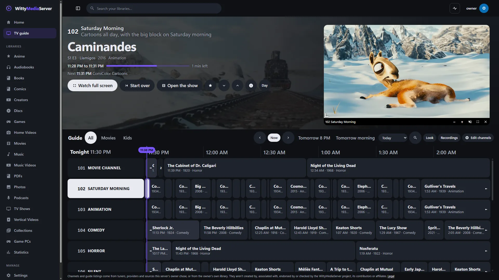
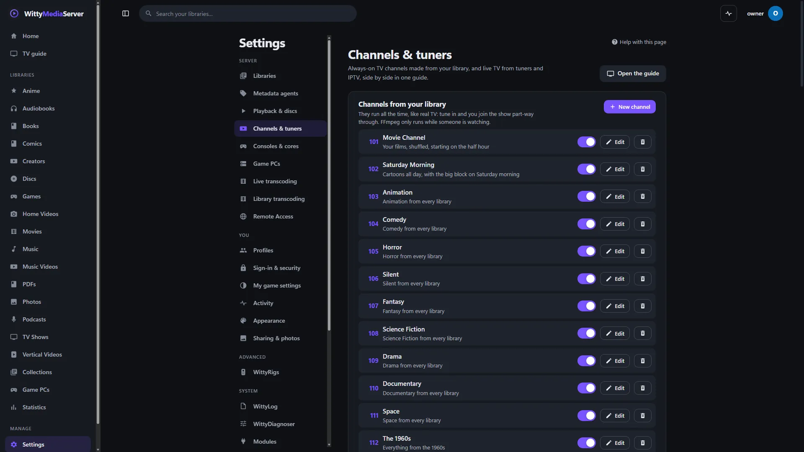
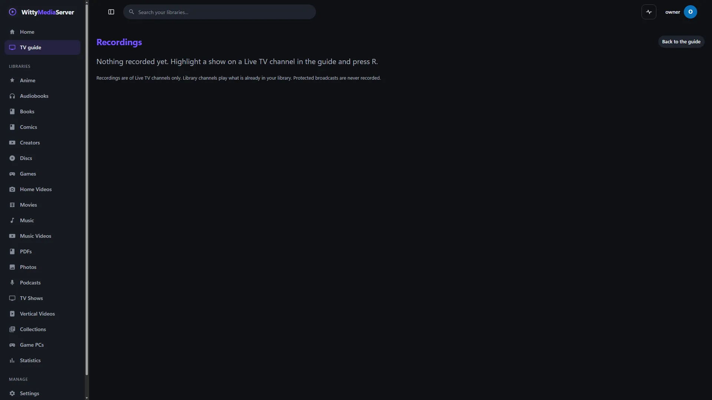

# WittyTuner

Brings live TV into WittyMediaServer: network tuners, IPTV playlists, capture cards and guide data. You need it if you want live TV or recording.

<!-- pictures -->



<sub>The guide, here with channels made from a library, playing [Caminandes: Llamigos](https://commons.wikimedia.org/wiki/File:Caminandes_3_-_Llamigos_-_Blender_Animated_Short.webm), Pablo Vazquez, Blender Foundation, [CC BY 3.0](https://creativecommons.org/licenses/by/3.0/). From a test server. The server's [credits list](https://github.com/wittywilla/WittyMediaServer/blob/master/docs/images/CREDITS.md) names everything shown.</sub>



<sub>Settings, Channels & tuners, on a server with no tuner attached.</sub>



<sub>Recordings, on a server with none yet.</sub>

<!-- /pictures -->

## What it does

A driver lists channels and opens one, as raw MPEG-TS or as options for FFmpeg.

| Driver | Reaches | Systems | How far it's been tested |
|---|---|---|---|
| `iptv` | M3U and M3U8 playlists | All | Automated tests, and FFmpeg against local streams |
| `xtream` | IPTV provider accounts on Xtream Codes-style panels: channels, groups, guide and catch-up | All | Against a stand-in panel, not a real provider |
| `stream` | One HTTP, HLS, RTSP, RTP, UDP, RTMP or SRT address | All | Automated tests, and FFmpeg against local streams |
| `network` | HDHomeRun-style network tuner boxes | All | Against a stand-in device, not real hardware |
| `backend` | TV servers over open protocols: an HTTP API with M3U and XMLTV, or SVDRP | All | Against stand-in servers, not a real one |
| `satip` | SAT>IP servers | All | Protocol tests, not real hardware |
| `dvb` | Linux DVB-T/T2, DVB-C, DVB-S/S2, ATSC, ClearQAM, ISDB-T, with band scans and `channels.conf` import | Linux | Parsers and band plans, not real hardware. No DiSEqC yet |
| `v4l2` | Analogue tuner and capture cards | Linux | Argument tests, not real hardware |
| `dshow` | Capture cards through DirectShow | Windows | Listing tested, not with a card |
| `avfoundation` | Capture devices | macOS | Parser tests only |
| `command` | Your own program writing MPEG-TS. Off unless the server is started with `WMS_TUNER_COMMANDS=1` | All | Automated tests with a test program |
| `bda` | Digital tuners through BDA | Windows | **Not built.** Listed so the gap is visible |

It also reads guide data from broadcasts (DVB EIT and ATSC PSIP) and from XMLTV files.

**Encrypted and copy-protected channels are refused,** with a clear message, and nothing is decrypted. It checks lineups, stream tables, the packets themselves as they play, DRM lines in playlists, and any key line in an HLS playlist. The check applies to every driver, and there's no way to change it. The server also watches every stream itself, whatever a module says.

No channel lists or stream addresses come with it. Band scans only say where a channel could be.

Recording and the guide stay with the server.

How to use it is in **Help** inside WittyMediaServer: see Channels and live TV.

## How to get it

An admin adds it from the module store inside WittyMediaServer: **Settings → Modules**, then **Browse the store**, then **Add** beside WittyTuner. That needs WittyMediaServer 0.6.0-alpha or later, and it works with nothing older. The range this version fits is in `module.json`: 0.6.0-alpha through 0.8.x.

## What it needs

- FFmpeg, which comes with the server.
- A tuner or an IPTV playlist.
- [WittyModule](https://github.com/wittywilla/WittyModule), which is how a server talks to it, built in.

It asks the server for three permissions: network, running programs, and devices. It's written in Go with no cgo.

## Platforms

A program is built for each system below, and the server uses the right one.

| System | Where it stands |
|---|---|
| Linux (x64, arm64, 32-bit ARM, x86) | Its tests pass on x64. No real tuner or capture card has been tried on any system. The other CPUs are only built |
| Windows (x64, arm64) | Built. This version hasn't been run on Windows since it became its own program |
| macOS (Intel, Apple silicon) | Built by the release tool. It has not been run on a real Mac |
| FreeBSD (amd64, arm64) | Cross-compiled only. It has not been run |

On macOS and FreeBSD the server has no sandbox for a module's helper: it gets a small environment and a soft memory limit, and nothing more.

## Building and testing

You need Go 1.26 or newer. In a worktree, first run the copy of `dev-modules.mjs` kept above the repositories (`node D:/projects/dev-modules.mjs` on the development machine). It writes a `go.work` that git ignores, so the checkout builds against the repositories beside it. Never run `go work use`.

```bash
go vet ./...
```

```bash
go test ./... -count=1
```

```bash
go run github.com/wittywilla/wittymodule/cmd/wittymodule check .
```

The last one checks the manifest. On the same tool, `pack -targets linux/amd64 -out release .` builds a release for one system. CI also builds for every system.

To use it as a library, `wittytuner.New(driver, config, env)` gives a source with `Channels` and `Open`. `wittytuner.Drivers(env)` describes every driver and its settings, and `wittytuner.Discover(ctx, env)` looks for tuners. The custom command driver stays off unless the host sets `Env.AllowCommands`.

## Licence

GNU Affero General Public License v3.0 (or later): see [LICENSE](LICENSE) and [NOTICE](NOTICE). If you redistribute it or build on it, please keep the NOTICE attribution. Each release archive carries a `THIRD-PARTY-NOTICES.txt` for what its programs link.

## Legal

WittyTuner is an independent open-source project. It isn't associated with, sponsored by or endorsed
by any tuner maker, broadcaster, IPTV provider or guide service. No channel lists or stream
addresses come with it. Encrypted channels are refused and nothing is decrypted. What a tuner or a
provider offers belongs to them, and you're responsible for having the rights to what you receive
and record. Any third-party names here only describe what it works with, and belong to their owners.
It's provided “as is”, with no warranty; see [LICENSE](LICENSE). Local law applies to how you use
it. This isn't legal advice.

<!-- module-kit -->
## Releasing

A version tag builds a program for every platform, signs the checksum list, and publishes a release that servers can install.

Versions move in small steps as work lands. `go run github.com/wittywilla/wittymodule/cmd/wittymodule@v0.3.0 bump .` raises it
everywhere it is written (add `-part minor` for a bigger step). A bump isn't a release: nothing is
tagged or published until you tag it. CI fails when code changed since the last tag and the version
didn't, because tags never move.

To release:

1. Check that `version` in `module.json` is the one to publish, with the bump committed.
2. Tag that commit and push the tag: `git tag vX.Y.Z`, then `git push origin vX.Y.Z`. A tag with a
   suffix, such as `v1.2.0-beta`, is published as a prerelease.
3. Watch the *Actions* tab. The signing step uses the `WMS_SIGNING_KEY` secret of the `release` environment, and nothing is published without it.

To take a version back, run the *withdraw* workflow from the *Actions* tab. It adds the version to a signed list on the release tagged `withdrawals`, which servers read.

Licensed under AGPL-3.0-or-later: see [LICENSE](LICENSE) and [NOTICE](NOTICE).
<!-- /module-kit -->
